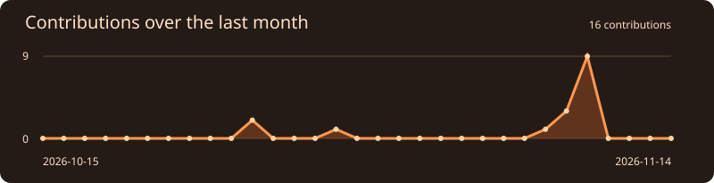

  <picture>
    <source media="(prefers-color-scheme: dark)" srcset="./assets/horizon-dark.svg">
    
  </picture>

<h1 align="center">Hey there, I'm Vibhav</h1>

  

  
  
  

<h2 align="center">About Me</h2>

<table align="center">
  <tr>
    <td width="65%" valign="middle">
      
My projects often start with a pile of text. In <a href="https://github.com/vibhav-22/promo-scout">Promo Scout</a>, the input is a microdrama screenplay. It finds 20–60 second clips and shows an editor where each one starts, what hooks the viewer, and which line leaves them hanging.

      
I also use Python for <a href="https://github.com/vibhav-22/document-extractor">document extraction</a> and <a href="https://github.com/vibhav-22/Document-classification-">classification</a>. For a different side of my work, take a look at my <a href="https://github.com/vibhav-22/chat-app">TypeScript chat app</a>.

    </td>
    <td width="35%" align="center"></td>
  </tr>
</table>

<h2 align="center">Tech Stack</h2>

  

<h2 align="center">GitHub Activity</h2>

  

  

<h2 align="center">Contribution Snake</h2>

<!-- GitHub Action: .github/workflows/snake.yml publishes both SVGs to the output branch daily. To generate them immediately, open Actions → Contribution snake → Run workflow. -->

  <picture>
    <source media="(prefers-color-scheme: dark)" srcset="https://raw.githubusercontent.com/vibhav-22/vibhav-22/output/snake-dark.svg">
    
  </picture>

<h2 align="center">Connect</h2>

  

  

